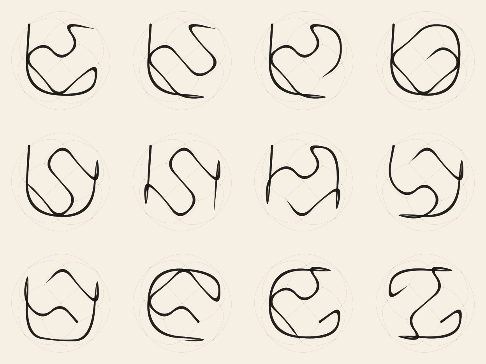
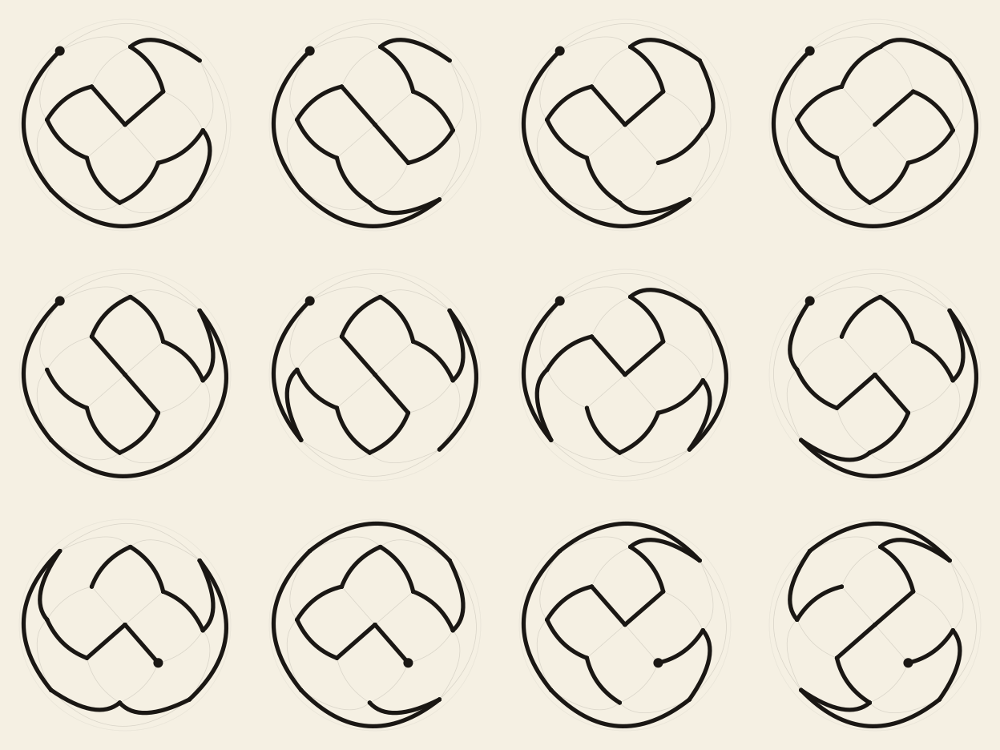
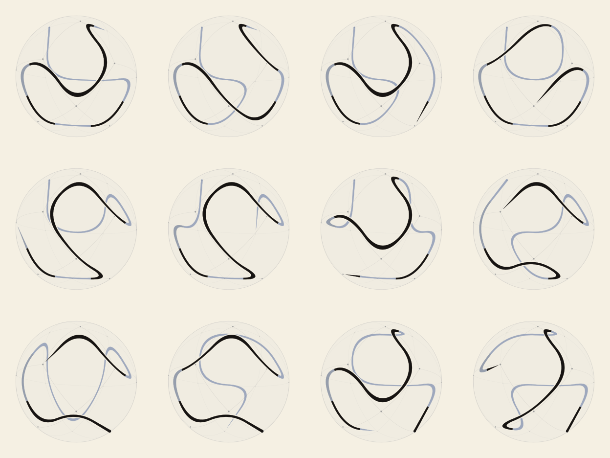
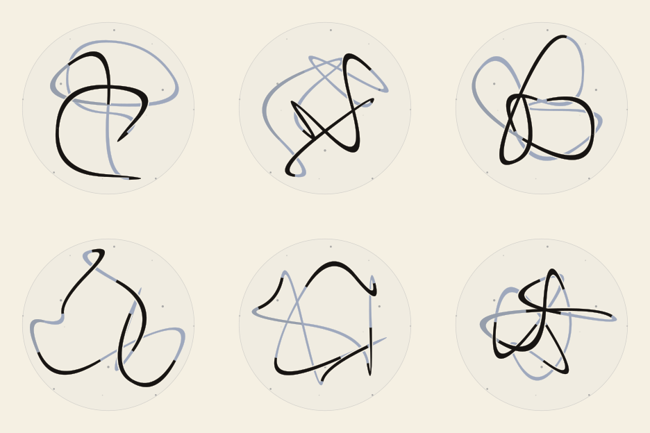

# sphere-glyphs

**Site:** <https://coldnebo.github.io/sphere-glyphs/>: the visual essay *Thirty million loops*, the interactive explorer, and the Library of all 29,940,480 glyphs.

A generative writing system built from the best possible arrangement of 13 points on a sphere.
Each glyph is a path through those points. It is projected onto the page and drawn with a brush
model that ranges from formal (seal script) to expressive (cursive). Rendering uses
[Penrose](https://penrose.cs.cmu.edu).

The points are the proven optimum of the 13-point
[Tammes problem](https://en.wikipedia.org/wiki/Tammes_problem), with a minimum separation of
57.1367°. Hamiltonian paths through its contact graph give 3,120 directed paths. Up to the
configuration's 8 symmetries and reversal, those reduce to **199 distinct glyphs**, about the
size of a syllabary.

| brush | seal |
|---|---|
|  |  |
| **glass**: transparent sphere, tilted | **stars**: chord loops *i → k·i mod 13* |
|  |  |

See [docs/DESIGN.md](docs/DESIGN.md) for the mathematics, the glyph model and future directions.

## Quick start

All you need is Docker and a bash shell (Git Bash on Windows works). Node and Python run inside the container.

```sh
scripts/test.sh                          # run the test suite in a container
scripts/dev.sh                           # shell in the dev container, repo mounted at /workspace/sphere-glyphs
scripts/dev.sh scripts/build-examples.sh # render every example into out/
```

Render a single glyph:

```sh
scripts/dev.sh node src/render.mjs penrose/tammes-glyph.domain \
    examples/glyphs/glyph-0000.substance penrose/styles/brush.style out/glyph.svg   # or .png
```

If you use VS Code, **Dev Containers: Reopen in Container** gives you the same environment.
See [docs/DEVELOPMENT.md](docs/DEVELOPMENT.md).

## Layout

```
src/              pipeline
  tammes.py         solve Tammes(N) numerically, extract the contact graph
  glyphs.py         orient the sphere, enumerate Hamiltonian paths, dedupe by symmetry -> Substances
  stars.py          spherical star loops i -> k*i mod 13 -> Substances
  loops.py          the 3 closed surface loops x star steps k = 1..6 -> 18 loop glyphs
  burnside.py       exact count of distinct loop glyphs: 29,940,480
site/              the GitHub Pages site: articles, explorer (spike/), the Library (library/), build.mjs
  spells.py         spell-book circles -> the 11-point sphere (icosahedron minus one) -> Substances
  render.mjs        render one Domain/Substance/Style trio to SVG or PNG
  sheet.mjs         tile many renders into a contact sheet
  penrose.mjs       shared headless Penrose helpers
penrose/          the Penrose program
  tammes-glyph.domain   Vertex, At(v,x,y,z), Contact, Step, Start, End
  styles/seal.style     formal: exact projected great-circle arcs, uniform weight
  styles/brush.style    expressive: momentum-rounded corners, pressure from turn sharpness
  styles/glass.style    transparent sphere, orthographic + tilt; back wash / halo / front ink
  styles/spell.style    graph glyphs (Link): each edge a tapered brush stroke
examples/         generated data, see examples/README.md
  tammes13.json     the 13-point optimum
  glyphs/           24 sample surface glyphs + glyphs.json (all 199)
  stars/            the six {13/k} star loops
  loops/            18 loop glyphs: 3 surface loops x k = 1..6
  spells/           5 spells from The Spell Writing Guide (Gorilla of Destiny), as 11-point sphere glyphs
docs/             DESIGN.md, DEVELOPMENT.md, images/
tests/            pytest + node:test
scripts/          dev.sh, test.sh (host); run-tests.sh, build-examples.sh (in-container)
```

The Substance files also paste directly into the [Penrose online editor](https://penrose.cs.cmu.edu/try/),
together with the Domain and one of the Styles.

## Knobs

- **Projection:** `v.k` in each style. It is currently Lambert equal-area about the 4-fold axis;
  stereographic would be `scale / (1 + z)`.
- **Pressure:** `hw = h0 * (1.55 - 0.85 * turn)` in `brush.style`. `base` sets the overall weight.
- **View:** `tilt` and `spin` in `glass.style`'s `view` block. Tilt 0.0 looks straight down the
  axis; values up to about 1.2 work. A page can replace the block with any rotation matrix.
- **Brush (glass.style):** `base` is the line weight. `momentum` sets how wide corners are cut:
  1 sweeps from chord midpoint to midpoint, and lower values turn closer to each point, with
  straight runs between. `pressure` scales the swelling on tight turns: 0 gives an even line.
  Try all three live in the site spike (`scripts/serve.sh`).
- **Pole and orientation:** `largest_hole` and `orient` in `src/glyphs.py`.

## Credits

- The spell circles in `examples/spells/` come from **_The Spell Writing Guide_** by Gorilla of
  Destiny ([DriveThruRPG](https://www.drivethrurpg.com/en/product/429711/the-spell-writing-guide),
  [author's site](https://www.gorillaofdestiny.com/books-and-compendiums)). The original
  designs belong to the author. See [examples/README.md](examples/README.md#spells).
- Rendering uses [Penrose](https://penrose.cs.cmu.edu) (Carnegie Mellon University).

## License

MIT, for the code in this repository. See [LICENSE](LICENSE). The spell data is the author's
and isn't covered by this license.
